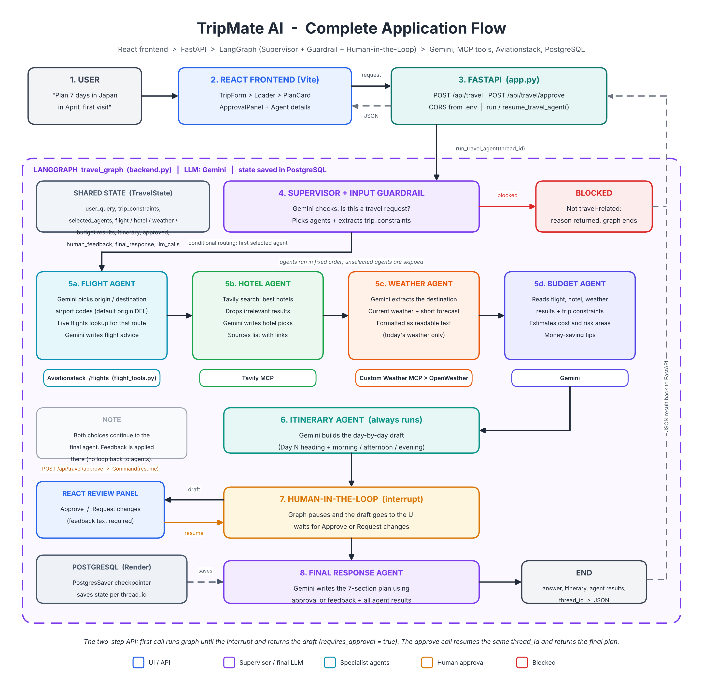

# TripMate AI – Multi-Agent Travel Planner

An AI-powered multi-agent travel planning application that researches flights, hotels, weather and budgets, then creates a personalized day-by-day travel itinerary. Built with **LangGraph**, the workflow uses a supervisor to understand the travel request, apply input guardrails and select the specialist agents required for the trip. The itinerary is presented as a draft first, allowing the user to approve it or request changes before the final travel plan is generated.

**Live demo:** https://langgraph-mcp-travel-assistant-1.onrender.com/

> **Note:** This project is deployed on Render's free tier. The backend may spin down after inactivity. The first request can take 50 seconds or more while the service starts. Please wait for the backend to wake up before retrying.

---

## Why this project

Planning a trip involves checking flights, comparing accommodation, understanding weather conditions, estimating expenses and organizing activities into a practical itinerary. Asking a general chatbot to do everything in one prompt can produce generic recommendations without a clear workflow or opportunity to review the result.

TripMate AI solves this by:

- Using a **Supervisor Agent** to understand the user's travel request and decide which specialist agents are required.
- Applying an **input guardrail** to restrict the application to travel-related requests.
- Extracting important trip constraints such as destination, origin, duration, budget and travel preferences.
- Using AviationStack to retrieve available live flight-operation information for a route.
- Using Tavily MCP to search for hotel and accommodation recommendations.
- Using a custom Weather MCP server integrated with OpenWeatherMap for current weather and forecast information.
- Using a Budget Agent to analyze estimated expenses, budget feasibility and money-saving opportunities.
- Using an Itinerary Agent to combine the specialist results into a practical day-by-day travel draft.
- Implementing **Human-in-the-Loop (HITL)** approval using LangGraph interrupts, allowing users to approve the itinerary or request revisions.
- Saving workflow state in PostgreSQL using LangGraph's Postgres checkpointer, so a paused workflow can resume using its thread ID.

---

## Architecture and overall flow

**How a travel request moves through the graph**

1. **Supervisor Agent (`supervisor_agent`)**: First checks the request using an input guardrail. If the request is allowed, it selects the required specialist agents and extracts trip constraints.
2. **Flight Agent (`flight_agent`)**: Uses AviationStack's flights endpoint to retrieve live flight-operation information. An LLM generates additional flight guidance, typical duration estimates and approximate airfare information, clearly distinguished from live data.
3. **Hotel Agent (`hotel_agent`)**: Uses Tavily MCP to search for hotels and accommodation. Relevant search results are filtered and summarized into recommendations with source links.
4. **Weather Agent (`weather_agent`)**: Uses the custom Weather MCP server to retrieve current weather and forecast information through OpenWeatherMap.
5. **Budget Agent (`budget_agent`)**: Analyzes flight, hotel and weather information along with the user's budget to estimate costs, identify budget risks and suggest savings.
6. **Itinerary Agent (`itinerary_agent`)**: Combines the selected specialist results and creates a structured day-by-day travel itinerary.
7. **Human-in-the-Loop (`human_approval_agent`)**: Uses LangGraph's `interrupt()` to pause the workflow and return the draft itinerary to the frontend.
   - **Approve:** The workflow resumes and generates the final polished travel plan.
   - **Request changes:** The workflow resumes with the user's feedback and revises the itinerary.
8. **Final Agent (`final_agent`)**: Produces the final response with trip summary, flight information, hotel suggestions, weather, day-by-day itinerary, estimated budget and recommendations.
9. **PostgreSQL Checkpointer**: Saves the graph state using `PostgresSaver`, allowing the approval workflow to resume with the same `thread_id`.

**Supervisor agent selection**

The supervisor dynamically selects the required agents based on the user's request. The itinerary agent is always included because it integrates the selected specialist results.

| Agent | Responsibility |
|---|---|
| `flight_agent` | Flight routes, airlines, live flight observations and booking guidance |
| `hotel_agent` | Hotel search, accommodation recommendations and source links |
| `weather_agent` | Current weather and short-term forecast information |
| `budget_agent` | Cost estimates, budget feasibility and savings |
| `itinerary_agent` | Integrated day-by-day travel itinerary |

The specialist agents execute in the graph's configured order when selected. The workflow then moves to itinerary generation and human approval.

---

## Tech stack

| Layer | Technology |
|---|---|
| Agent workflow | LangGraph |
| LLM | Google Gemini (`langchain-google-genai`, `gemini-3.1-flash-lite`) |
| Flight information | AviationStack API |
| Web search | Tavily MCP |
| Weather information | Custom FastMCP server, OpenWeatherMap API |
| MCP integration | Model Context Protocol, `langchain-mcp-adapters` |
| State and checkpoints | PostgreSQL, `psycopg`, `langgraph-checkpoint-postgres` |
| Backend API | FastAPI, Uvicorn |
| Frontend | React, Vite, React Markdown |
| Styling | Hand-written CSS |
| Deployment | Render (Backend Web Service + Frontend Web Service) |

---

## Project structure

```text
LangGraph-MCP-Travel-Assistant/
├── Backend/
│   ├── app.py                  # FastAPI application and REST endpoints
│   ├── backend.py              # LangGraph workflow, agents, routing and HITL
│   ├── flight_tools.py         # AviationStack flight API integration
│   ├── mcp_client.py           # Tavily and Weather MCP client integration
│   ├── weather MCP server      # Custom FastMCP server using OpenWeatherMap
│   ├── requirements.txt        # Python dependencies
│   └── .env                    # Backend environment variables (not committed)
│
├── Frontend/
│   ├── src/
│   │   ├── components/
│   │   │   ├── AgentChips.jsx
│   │   │   ├── ApprovalPanel.jsx
│   │   │   ├── DetailsPanel.jsx
│   │   │   ├── Header.jsx
│   │   │   ├── Loader.jsx
│   │   │   ├── PlanCard.jsx
│   │   │   └── TripForm.jsx
│   │   ├── api.js              # Backend API calls
│   │   ├── App.jsx             # Main React application and UI state
│   │   ├── main.jsx            # React entry point
│   │   └── styles.css          # Application styling
│   ├── index.html
│   ├── package.json
│   ├── vite.config.js
│   └── .env                    # Frontend environment variables (not committed)
│
├── .gitignore
└── README.md
```

*The weather MCP server filename and any additional configuration files should match their actual names in your repository.*

---

## Local setup

Set up the **backend completely first**, then the frontend.

### Prerequisites

- **Python 3.12.3** (the version used in the working local environment)
- **Node.js 18 or newer** and npm
- Git
- A PostgreSQL database (a free [Render PostgreSQL](https://render.com/) database or another PostgreSQL provider can be used)
- API keys:
  - [Google AI Studio](https://aistudio.google.com/) for `GOOGLE_API_KEY`
  - [AviationStack](https://aviationstack.com/) for `AVIATIONSTACK_API_KEY`
  - [Tavily](https://tavily.com/) for `TAVILY_API_KEY`
  - [OpenWeatherMap](https://openweathermap.org/api) for `OPENWEATHER_API_KEY`
  - [LangSmith](https://smith.langchain.com/) for optional tracing

### Step 1: Clone the repository

```bash
git clone <YOUR_GITHUB_REPOSITORY_URL>
cd LangGraph-MCP-Travel-Assistant
```

---

## Part 1: Backend

### 1.1 Create a virtual environment and install dependencies

```bash
cd Backend

python3.12 -m venv venv
```

Activate it:

```bash
# macOS / Linux
source venv/bin/activate

# Windows (PowerShell)
venv\Scripts\Activate.ps1
```

Install the packages:

```bash
pip install -r requirements.txt
```

### 1.2 Create `Backend/.env`

Create a file named `.env` inside the `Backend/` folder and add your own values. Never commit this file to GitHub.

```env
# Google Gemini
GOOGLE_API_KEY=your_google_api_key

# AviationStack
AVIATIONSTACK_API_KEY=your_aviationstack_api_key

# Tavily MCP
TAVILY_API_KEY=your_tavily_api_key

# OpenWeatherMap
OPENWEATHER_API_KEY=your_openweathermap_api_key

# PostgreSQL connection
DATABASE_URL=your_postgresql_connection_url

# Default origin airport
DEFAULT_ORIGIN_IATA=DEL

# Frontend origins allowed by FastAPI CORS (comma separated)
FRONTEND_ORIGINS=http://localhost:5173,http://127.0.0.1:5173

# Optional LangSmith tracing
LANGCHAIN_TRACING=true
LANGCHAIN_ENDPOINT=https://api.smith.langchain.com
LANGCHAIN_API_KEY=your_langsmith_api_key
LANGCHAIN_PROJECT=TRAVEL-AGENT
```

**Important:**

- Replace every placeholder with your own credentials.
- `DATABASE_URL` should be a PostgreSQL connection URL accessible from your backend.
- The application adds `sslmode=require` if it is not already present in the database URL.
- `DEFAULT_ORIGIN_IATA` defaults to `DEL` if it is not configured.
- `FRONTEND_ORIGINS` must contain the exact origin(s) of your frontend.
- Never expose API keys or database credentials in your frontend code.

### 1.3 Configure PostgreSQL

The application uses LangGraph's `PostgresSaver` to persist graph state.

The database connection is read from `DATABASE_URL` in the environment.

The backend initializes the checkpointer using:

```python
checkpointer = PostgresSaver(_conn)
checkpointer.setup()

travel_graph = graph.compile(checkpointer=checkpointer)
```

The checkpoint setup is performed automatically when the backend initializes. You do not need to manually create LangGraph checkpoint tables.

**Why PostgreSQL is important here:**

The workflow pauses at the human approval node. When the user approves or requests changes, the backend resumes the same graph execution using the original `thread_id`.

Do not change the thread ID between the initial travel request and the approval request.

### 1.4 Start the backend

From the `Backend/` directory, with your virtual environment activated:

```bash
python app.py
```

Or run Uvicorn directly:

```bash
uvicorn app:app --reload --host 127.0.0.1 --port 8000
```

The backend runs on:

**http://127.0.0.1:8000**

Check that it works:

- Health check: http://127.0.0.1:8000/health
- API documentation: http://127.0.0.1:8000/docs

Keep this terminal running and open a new terminal for the frontend.

---

## Part 2: Frontend

Do this only after the backend is running.

### 2.1 Install dependencies

```bash
cd Frontend
npm install
```

### 2.2 Create `Frontend/.env`

Create a file named `.env` inside the `Frontend/` folder:

```env
VITE_API_URL=http://127.0.0.1:8000
```

For local development, this points the React application to the local FastAPI backend.

For production, configure `VITE_API_URL` in your frontend hosting environment with the deployed backend URL.

For example:

```env
VITE_API_URL=https://your-backend-service.onrender.com
```

The variable name must start with `VITE_`. Vite reads environment variables during the build, so restart the development server after changing the file.

### 2.3 Start the frontend

```bash
npm run dev
```

Open:

**http://localhost:5173**

Enter a travel request and click **Plan my trip**.

Example requests:

- "Plan a 5-day trip from Delhi to Goa under ₹40,000."
- "Weekend in Paris for two, mid-range budget, love food and museums."
- "7 days in Japan in April, first-time visitor."
- "Plan a 3-day trip to Singapore with a budget of ₹50,000."

The frontend provides:

- A travel request form with example prompts.
- Agent chips showing which specialist agents were selected.
- The supervisor's reasoning.
- A Markdown-rendered draft itinerary.
- An approval panel with Approve and Request changes options.
- Expandable agent details for flight, hotel, weather and budget results.
- A final travel plan after the approval workflow completes.

### 2.4 Production build (optional)

```bash
npm run build
```

The production files are created in `Frontend/dist`.

---

## API endpoints

The FastAPI backend exposes the following endpoints:

| Method | Endpoint | Description |
|---|---|---|
| `POST` | `/api/travel` | Starts a new travel-planning workflow |
| `POST` | `/api/travel/approve` | Resumes the workflow after approval or revision feedback |
| `GET` | `/health` | Backend health check |

### Start a travel plan

**POST `/api/travel`**

Request body:

```json
{
  "message": "Plan a 5-day trip from Delhi to Goa under 40000 rupees",
  "thread_id": null
}
```

The backend starts a new LangGraph execution and returns the draft itinerary along with the `thread_id`, selected agents and other specialist results.

### Approve or request changes

**POST `/api/travel/approve`**

Request body:

```json
{
  "thread_id": "thread_id_returned_by_the_first_request",
  "approved": true,
  "feedback": ""
}
```

To request changes:

```json
{
  "thread_id": "thread_id_returned_by_the_first_request",
  "approved": false,
  "feedback": "Suggest cheaper hotels and include more local food places."
}
```

---

## Troubleshooting

| Problem | Likely cause and fix |
|---|---|
| `Request failed (200)` in the frontend | Check whether `api.js` uses `API_BASE` in its `fetch()` URL. Ensure `VITE_API_URL` points to the backend, not the frontend service. |
| CORS error in the browser | Add the exact deployed frontend origin to `FRONTEND_ORIGINS` in the backend environment and redeploy. |
| First request is slow on Render | The free instance may have spun down. Wait for the backend to start and retry. |
| Python or MCP errors on Render | Use the same Python version and compatible dependency versions as your working local environment. This project was tested locally with Python 3.12.3. |
| Hotel agent cannot retrieve results | Check `TAVILY_API_KEY`, Tavily MCP initialization and backend logs. |
| Weather agent cannot retrieve results | Check `OPENWEATHER_API_KEY`, the Weather MCP server configuration and backend logs. |
| Flight information is unavailable | Check `AVIATIONSTACK_API_KEY` and the flight API response. The available endpoint provides live flight operations, not future schedules or ticket prices. |
| Database connection error | Check `DATABASE_URL`, PostgreSQL availability and SSL connection settings. |
| Approval request fails | Ensure you send the exact `thread_id` returned by the initial `/api/travel` request. |
| Approval request says feedback is required | When `approved` is `false`, provide non-empty revision feedback. |
| Gemini quota or rate-limit errors | Check your Google AI Studio quota and API key. |
| LangSmith shows no traces | Check `LANGCHAIN_TRACING`, `LANGCHAIN_API_KEY` and `LANGCHAIN_ENDPOINT`. |

---

## Author

Built by **Nitish Garg** ([@nitishgarg1](https://github.com/nitishgarg1)).
